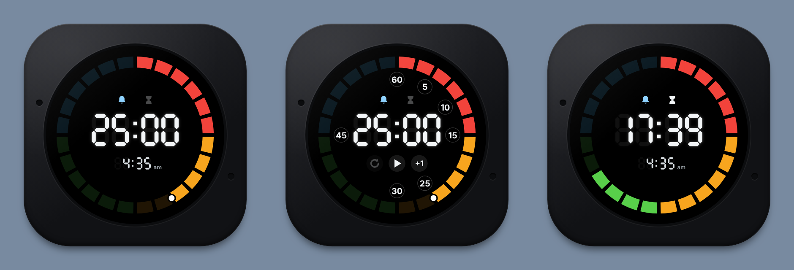

# Focus Widget

A small countdown timer that sits on your desktop, inspired by physical time-cube timers. The whole widget is the dial: a ring of colored segments that empties as time runs out, with the controls tucked inside it.



Works on macOS, Windows and Linux.

## Features

- Quick timers (5, 10, 15, 25, 30, 45 and 60 minutes) that start with one click
- Set any length from 1 to 99 minutes by dragging around the ring, scrolling, or using the arrow keys
- Stays on top of other windows, and you can move it anywhere by dragging the frame
- A chime and a system notification when time is up, then a count of the time past zero
- Three sizes, a tray or menu bar icon, and a count of the timers you finish each day
- Works offline and collects no data

## Install

Download the installer for your system from the [Releases](../../releases) page:

| System | File |
| --- | --- |
| macOS (Apple chip) | `focus-widget-<version>-mac-arm64.dmg` |
| macOS (Intel) | `focus-widget-<version>-mac-x64.dmg` |
| Windows | `focus-widget-<version>-win-x64.exe` |
| Linux (Debian, Ubuntu) | `focus-widget-<version>-linux-x64.deb` |
| Linux (other) | `focus-widget-<version>-linux-x64.tar.gz` |

The installers aren't signed with a paid developer certificate, so your system will warn you the first time:

- **macOS:** open the app once, then go to System Settings, Privacy & Security, and choose Open Anyway. Needs macOS 12 or newer.
- **Windows:** when SmartScreen appears, choose More info, then Run anyway. The widget uses the Microsoft Edge WebView2 Runtime, which Windows 11 and current Windows 10 include.
- **Linux:** install the package with `sudo apt install ./focus-widget-*.deb`. For the `.tar.gz`, install GTK 3 and WebKitGTK 4.1 from your distribution, unpack it and run `focus-widget`.

### Coming from version 0.1

Version 0.2 is a rewrite in Go, so it installs as a new app. Uninstall the old version, or quit it before starting the new one. The new version picks up the old window position, size and keep-on-top setting. The sound setting, the last timer length and today's tally start fresh once.

## Using the widget

- **Move it:** drag the black frame.
- **Controls:** move the pointer over the screen. The current time gives way to three buttons: reset, start or pause, and +1 minute. Clicking the big countdown digits also starts or pauses.
- **Quick timers:** when the timer isn't running, the hover view shows the quick timers at their own spot on the dial. Click one to start it.
- **Your own length:** drag around the colored ring or scroll over the dial.
- **Sound:** click the bell on the screen.
- **Menu:** right-click the widget, or use the tray icon (menu bar on macOS), for quick timers, sound, keep on top, size, today's tally, hide and quit.
- **Tray icon:** on macOS, click the menu bar icon to bring the widget to the front, on the desktop you are using; right-click or Control-click it for the menu. On Windows, click it to show or hide the widget and right-click it for the menu.

When time is up, the ring flashes, the digits turn red and count the time past zero, and a chime plays for about 25 seconds. Click the digits to dismiss it, or press +1 for one more minute.

Closing the window (for example with Alt+F4) only hides it. Click the tray icon or use **Show widget** in the tray menu to bring it back, and **Quit Focus Widget** to quit. Opening the app again while it runs also brings the widget forward.

### Keyboard shortcuts

These work after you click the widget.

| Key | Action |
| --- | --- |
| Space or Enter | Start, pause, resume, or dismiss the alarm |
| R | Reset |
| Up and down arrows | One minute more or less |
| 1 to 7 | Start a quick timer |
| M | Sound on or off |
| Escape | Dismiss the alarm |

## Run from source

You need [Go](https://go.dev/dl/) (the version in `go.mod` or newer) and, depending on your system:

- **macOS:** the Xcode Command Line Tools (`xcode-select --install`).
- **Windows:** nothing else.
- **Linux:** gcc and the GTK 3 and WebKitGTK 4.1 development packages, for example `sudo apt install gcc libgtk-3-dev libwebkit2gtk-4.1-dev`.

```bash
git clone <this repository's URL>
cd focus-widget
go run -tags private_mac_apis .   # macOS
go run .                          # Windows
go run -tags gtk3 .               # Linux
```

Run the tests with `go test ./...` (on Linux, `go test -tags gtk3 ./...`).

To build installers, run the script for your system from the repository root. The files appear in the `dist` folder.

| System | Command | Output |
| --- | --- | --- |
| macOS | `build/macos/package.sh arm64` or `amd64` | DMG |
| Windows | `build/windows/package.sh` in Git Bash, with [NSIS](https://nsis.sourceforge.io) installed | Installer |
| Linux | `build/linux/package.sh` | `.deb` and `.tar.gz` |

### Project layout

| Path | What it does |
| --- | --- |
| `main.go`, `app.go` | Starts the app; the window, tray icon and menus, and the calls the page can make |
| `core.go`, `timer.go` | The timer, today's tally, the tray countdown and when to wake up |
| `sound.go` | The chime, generated and played natively |
| `store.go` | Saves settings to `settings.json` |
| `native_darwin.go` | macOS only: keeps App Nap from delaying a running timer, and spots Control-clicks on the menu bar icon |
| `renderer/` | The widget page: it draws the dial from the state Go sends and passes clicks and keys back |
| `assets/` | App and tray icons |
| `build/` | Packaging for each system |
| `.github/workflows/release.yml` | Builds the installers and publishes releases |

## Releasing a new version

1. Update the version in `VERSION` and commit.
2. Tag the commit and push the tag, for example `git tag v1.1.0` and `git push origin v1.1.0`. The tag must match `VERSION`.
3. The **Build and release** workflow tests and builds the installers on macOS, Windows and Linux and attaches them to a new GitHub release.

You can also run the workflow by hand from the Actions tab to build installers without publishing a release.

## Troubleshooting

- **Linux shows a black box instead of a see-through window:** transparency needs a compositing window manager. Most desktops have one turned on.
- **Linux has no tray icon:** some desktops (GNOME in particular) need the AppIndicator extension.
- **No notification on macOS:** macOS asks for permission the first time a timer finishes. Unsigned apps may still not get notifications. The chime and the flashing dial work either way.
- **Windows says WebView2 is missing:** install the [WebView2 Runtime](https://developer.microsoft.com/microsoft-edge/webview2/).
- **No sound:** check that the bell on the dial is lit and that your system volume is up.

## Privacy and security

- The widget makes no network requests and collects no data.
- Settings stay on your computer in `settings.json`: in `~/Library/Application Support/Focus Widget` on macOS, `%AppData%\Focus Widget` on Windows and `~/.config/Focus Widget` on Linux.
- The page only draws. The timer, sound and settings live in the Go app, and the page can make four calls (get the state, run a timer action, show the window, open the menu). Go checks each call and refuses unknown actions and out-of-range lengths.
- A strict Content Security Policy allows only the app's own files. Camera, microphone, location, notification and clipboard requests from the page are denied.
- Wails, the framework the app uses, has no switch to block navigation, so the page itself has no links or forms and loads nothing from outside.
- Go modules and GitHub Actions are pinned to exact versions (`go.sum` holds checksums), and Dependabot proposes updates once they're at least two weeks old.

To report a security problem, please use GitHub's private vulnerability reporting on this repository rather than a public issue.

## Contributing

Issues and pull requests are welcome. Please run `go test ./...`, try your change with `go run` on at least one system, and describe what you tried.

## License

[MIT](LICENSE)
